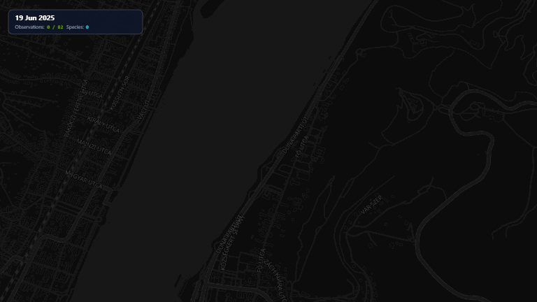
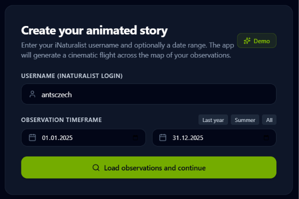
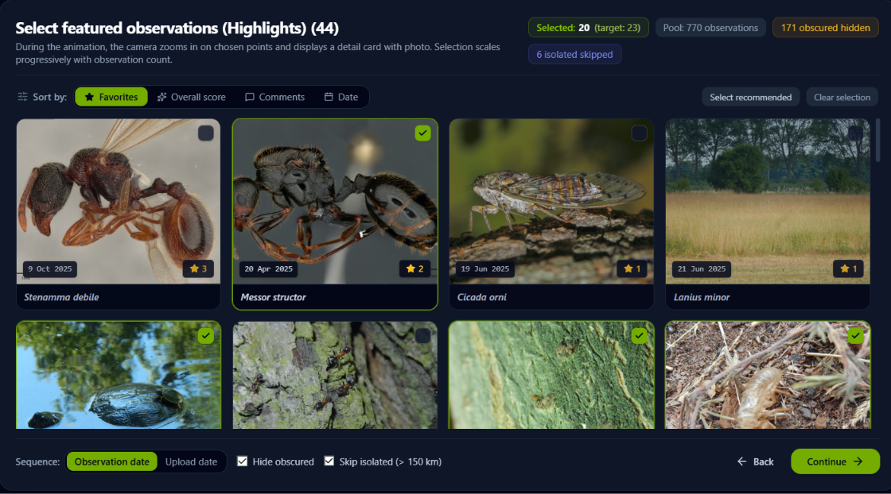
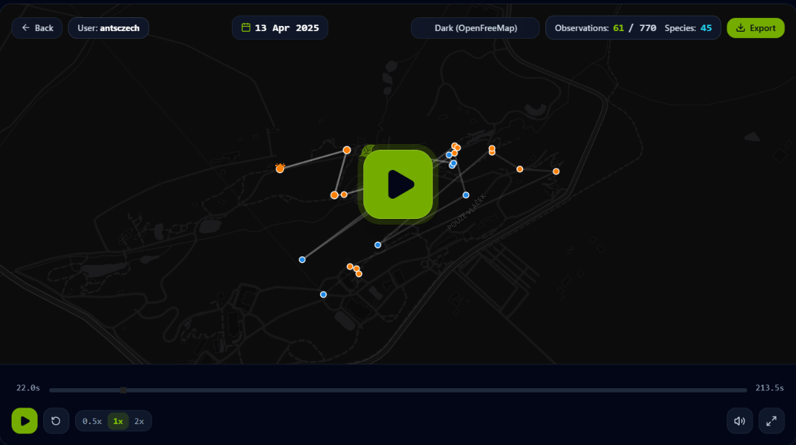
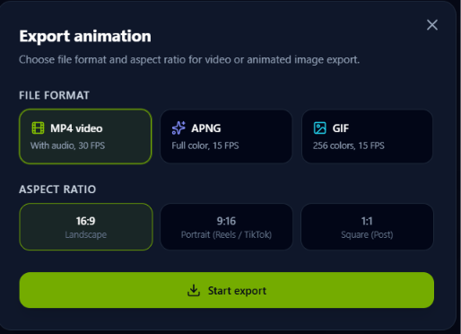

[Česká verze / Czech version](docs/README.cs.md)

# MyiNatAnimated

Animated map stories from your iNaturalist observations.

Transform your field findings, expeditions, or annual recaps into a smooth cinematographic video or animated GIF featuring reactive camera motion, sound effects, and highlights of key species.



---

# PART I: OVERVIEW, OUTPUTS, AND USER GUIDE

## What the Application Does

Are you active on iNaturalist and want to share your observations in an engaging video format? **MyiNatAnimated** loads public data for any user over a selected time period and creates a dynamic animated map:

- **Dynamic Camera:** Automatically tracks the trajectory of your findings. It smoothly zooms in on dense clusters of observations and performs an elegant high-altitude sweeping pan and zoom-out during long transitions (such as traveling across mountain ranges or country borders).
- **Audio-Visual Effects:** Each recorded observation pulses on the map and pops up a themed taxon icon (plants, insects, fungi, birds, etc.) colored to match the iNaturalist aesthetic.
- **Procedural Sound Design:** A Web Audio synthesizer produces pentatonic chime notes on every observation, fanfare chords upon discovering key species, and ambient wind rush during swift camera flights.
- **Highlight Selection:** A smart scoring algorithm automatically selects standout observations (based on favorites, comments, and *Research Grade* status), which you can curate in an interactive grid.
- **100% Client-Side in the Browser:** All data computation, graphic compositing, and video encoding occur directly on your local device. No user data is sent to external servers.

---

## Generated Outputs

Directly download from the app:

1. **MP4 Video with Synchronized Audio:**
   - Encoded in H.264 video with AAC audio (in high resolution).
   - One-click aspect ratio selection:
     - **16:9 (Landscape):** Ideal for YouTube, presentations, and desktop displays.
     - **9:16 (Portrait):** Optimized for Instagram Reels, TikTok, and YouTube Shorts.
     - **1:1 (Square):** Suited for social media timeline posts.
2. **Animated APNG:**
   - Full 24-bit color animation with high fidelity, smoother and richer than standard GIF.
3. **Animated GIF:**
   - Lightweight and convenient for forum posts, blog articles, and chat platforms.
4. **Interactive Web Experience:**
   - Play the interactive map story directly in your browser, with pause controls, a scrubbable timeline, and switchable map styles (Dark, Liberty, Positron, Bright).

---

## How to Run the App

### 1. Online in the Browser (No Installation Required)
The application is hosted online via GitHub Pages:
**[https://sidlocz.github.io/MyiNatAnimated/](https://sidlocz.github.io/MyiNatAnimated/)**

### 2. Running Locally (Windows / macOS / Linux)

Because modern web applications rely on Web Workers, vector map tiles, and ES modules, opening `index.html` directly via the `file://` protocol is blocked by browsers due to CORS security policies. Follow these steps to run locally:

1. Install [Node.js](https://nodejs.org/) (version 18 or higher).
2. Open the project root folder and install dependencies:
   ```bash
   npm install
   ```
3. Launch the application using one of the following methods:
   - **On Windows:** Double-click `start.bat`.
   - **From the terminal:**
     ```bash
     npm run dev
     ```
     Open your browser at `http://localhost:3000`.
   - **Production preview:**
     ```bash
     npm run build
     npm run preview
     ```

---

## Step-by-Step Guide: Creating Your Story

### Step 1: User and Date Range Selection
Enter your iNaturalist username (or any naturalist's username). Choose a specific date range (type directly in `yyyy/mm/dd` format or use the interactive calendar), or use the quick preset buttons (*Last year*, *Summer*, *All*). If you want to test the app right away, click the **Demo** button to instantly load sample data.



### Step 2: Highlight Selection and Filtering
The app sorts observations and suggests optimal highlight findings:
- Click any taxon card to toggle its inclusion in the highlight reel, or use *Select recommended* / *Clear selection*.
- **Obscured Coordinates Filter:** Exclude taxa with intentionally obscured coordinates (threatened species) to prevent sudden camera jumps.
- **Isolated Findings Filter:** Hide solitary outlier observations located hundreds of kilometers away from the main route to keep camera movements smooth and focused.
- **Sorting Order:** Sort findings by overall score, favorites, comments, or date.



### Step 3: Playback and Map Controls
Clicking *Load observations and continue* triggers asset preparation (calculating camera keyframes, rasterizing vector icon sprites, and pre-caching map tiles). The interactive player then starts:
- Pause or resume playback anytime using the spacebar or on-screen controls.
- Use the smooth custom timeline scrubber to immediately jump to any point in the journey.
- Switch map styles (**Dark**, **Liberty**, **Positron**, **Bright**) from the control panel in the top-right corner.



### Step 4: Exporting Video and GIF
Click the **Export** button to open the export configuration dialog:
- Choose your map theme: **Dark**, **Liberty**, **Positron**, or **Bright**.
- Select your target format: **MP4 Video with Audio**, **APNG**, or **Animated GIF**.
- Choose your aspect ratio: **16:9**, **9:16 (Shorts/Reels)**, or **1:1**.
- Click *Start export*. The recording renders deterministically in a few seconds with 1.5x scaled UI cards for maximum readability and prompts you to download the finished file.



---

# PART II: ARCHITECTURE AND TECHNICAL DETAILS

## Technology Stack

- **Frontend Core:** React 18, TypeScript, Vite
- **Styling and UI:** Tailwind CSS, Lucide React (inline SVG icons)
- **Map Engine:** MapLibre GL JS with free vector tile styles from OpenFreeMap (no API keys or registrations required)
- **Audio Synthesis:** Web Audio API (procedural synthesis without external audio files)
- **Media Encoding:** `mp4-muxer` and WebCodecs API (with fallback to `MediaRecorder`), `gifenc` for animated GIFs
- **Local Storage / Cache:** IndexedDB via `idb-keyval`
- **Testing:** Vitest

## Animation Core Architecture

The codebase is organized into modular components under `src/`:

- `src/engine/cameraDirector.ts`:
  - Cinematographic camera director. Computes observation center of mass over time, applies smooth dampening (spring/lerp), resolves initial clusters, and triggers elevated arc pans for long distances.
- `src/engine/dopamineCanvas.ts`:
  - Canvas overlay layer rendering shockwaves, radiant pulse rings, and dynamic trail lines.
- `src/engine/spriteAtlas.ts`:
  - Rasterizes inline SVG taxon glyphs into an atlas bitmap for optimal rendering performance (60 fps) without DOM thrashing.
- `src/engine/soundEngine.ts`:
  - Polyphonic procedural sound synthesizer. Uses frequency oscillators and noise generators to simulate pentatonic chimes and atmospheric wind speed during rapid flights.
- `src/engine/videoExporter.ts` and `src/engine/gifExporter.ts`:
  - Deterministic offline renderers. Steps simulated time in fixed increments regardless of hardware CPU/GPU speed, ensuring jitter-free output on any system.
- `src/services/inatApi.ts` and `src/services/requestQueue.ts`:
  - Rate-limited iNaturalist API v1 client. Enforces a respectful maximum request rate of 1 request per 1.1 s, cursor pagination using `id_above`, and stores full responses in IndexedDB.

---

## Developer Commands

- **Install dependencies:** `npm install`
- **Start development server:** `npm run dev`
- **Run test suite:** `npm test`
- **Type check and lint:** `npm run lint`
- **Build production bundle:** `npm run build`
- **Preview production build:** `npm run preview`
