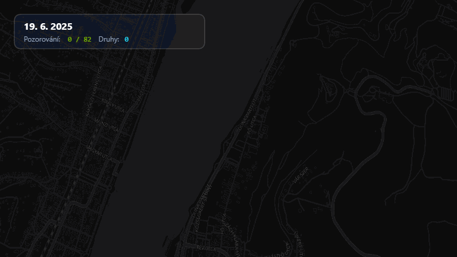

# MyiNatAnimated

Animovaný mapový příběh z vašich pozorování na síti iNaturalist.

Aplikace promění vaše terénní nálezy, expedice nebo celoroční bilanci do plynulého kinematografického videa či animovaného GIFu s reaktivním pohybem kamery, zvukovými efekty a prezentací nejzajímavějších druhů.



---

# ČÁST I: PŘEHLED, VÝSTUPY A NÁVOD K POUŽITÍ

## K čemu aplikace slouží

Jste aktivní na iNaturalistu a chcete se podělit o svá pozorování v poutavém video formátu? **MyiNatAnimated** načte veřejná data libovolného uživatele za vybrané období a vytvoří dynamickou animovanou mapu:

- **Dynamická kamera:** Automaticky sleduje trasu vašich nálezů. Na místech s více pozorováními plynule přibližuje detaily, při delších přesunech (např. přejezd mezi pohořími či státy) provede elegantní vysoký přelet s oddálením.
- **Dopaminové audio-vizuální efekty:** Každé zaznamenané pozorování na mapě pulzuje a vystřelí tematickou ikonu taxonu (rostliny, hmyz, houby, ptáci apod.) s barevným laděním podle iNaturalistu.
- **Procedurální zvukový doprovod:** Web Audio syntezátor generuje pentatonické tóny při každém nálezu, slavnostní akordy při objevení klíčových druhů a větrný svist při přeletech kamery.
- **Výběr highlightů:** Chytrý algoritmus automaticky vybere nejzajímavější nálezy (podle oblíbenosti, komentářů a statusu *Research Grade*), které si můžete v přehledné mřížce sami doupravit.
- **100% v prohlížeči bez registrace:** Veškerý výpočet, příprava grafiky i kódování videa probíhá přímo na vašem zařízení. Žádná data se neposílají na cizí servery.

---

## Co aplikace vygeneruje

Z aplikace můžete přímo stáhnout:

1. **MP4 video se synchronizovaným zvukem:**
   - Kódováno v H.264 videu s AAC zvukem (ve vysokém rozlišení).
   - Výběr poměru stran jedním kliknutím:
     - **16:9 (na šířku):** Ideální pro YouTube, prezentace a televize.
     - **9:16 (na výšku):** Optimalizováno pro Instagram Reels, TikTok a YouTube Shorts.
     - **1:1 (čtverec):** Vhodné pro příspěvky na sociální sítě.
2. **Animovaný GIF:**
   - Vhodný pro rychlé sdílení na fórech, v blozích nebo chatu.
3. **Interaktivní zážitek na webu:**
   - Možnost přehrávat mapový příběh přímo v prohlížeči, libovolně zastavovat, posouvat časovou osu a přepínat mezi mapovými styly (Dark, Satelitní, Voyage, Světlý).

---

## Jak aplikaci spustit

### 1. Online v prohlížeči (bez instalace)
Aplikace běží online na GitHub Pages:
**[https://sidlocz.github.io/MyiNatAnimated/](https://sidlocz.github.io/MyiNatAnimated/)**

### 2. Lokální spuštění na vlastním počítači (Windows / macOS / Linux)

Vzhledem k tomu, že moderní webové aplikace využívají Web Workery, mapové podklady a ES moduly, nelze soubor `index.html` otevírat pouhým poklepáním přes protokol `file://` (prohlížeče z bezpečnostních důvodů blokují CORS). Pro lokální běh postupujte takto:

1. Nainstalujte si [Node.js](https://nodejs.org/) (verze 18 nebo vyšší).
2. Otevřete složku projektu a nainstalujte potřebné knihovny:
   ```bash
   npm install
   ```
3. Spusťte aplikaci jedním z těchto způsobů:
   - **Na Windows:** Poklepejte na soubor `start.bat`.
   - **V terminálu:**
     ```bash
     npm run dev
     ```
     Otevřete prohlížeč na adrese `http://localhost:3000`.
   - **Produkční náhled:**
     ```bash
     npm run build
     npm run preview
     ```

---

## Návod krok za krokem: Jak vytvořit svůj příběh

### Krok 1: Výběr uživatele a období
Do pole zadejte své uživatelské jméno na iNaturalistu (případně jméno libovolného jiného přírodovědce). Můžete zvolit konkrétní časové rozmezí, nebo využít rychlá tlačítka (*Minulý rok*, *Léto*, *Vše*). Chcete-li si aplikaci jen vyzkoušet, klikněte na tlačítko **Demo**, které okamžitě načte ukázková data.

*(Obrázek obrazovky: `docs/images/01_vyhledavani.png`)*

### Krok 2: Výběr highlightů a filtrování
Aplikace seřadí pozorování a navrhne až 12 nejvýznamnějších nálezů.
- Kliknutím na kartu druhu můžete pozorování přidat do výběru nebo jej odebrat.
- **Filtr zastřených souřadnic:** Umožňuje vyloučit druhy se záměrně znepřesněnou polohou (ohrožené taxony), aby v mapě nevznikaly umělé skoky.
- **Filtr izolovaných nálezů:** Umožňuje skrýt ojedinělá pozorování vzdálená stovky kilometrů od hlavní trasy, aby kamera zůstala plynule zaměřena na hlavní lokalitu.
- **Řazení:** Zvolte, zda se má příběh odvíjet podle skutečného data nálezu v terénu, nebo podle data nahrání na iNaturalist.

*(Obrázek obrazovky: `docs/images/02_vyber_highlightu.png`)*

### Krok 3: Přehrávání a ovládání mapy
Po kliknutí na *Vytvořit příběh* proběhne rychlá příprava (vygenerování klíčových snímků kamery, atlasu vektorových ikon a přednačtení mapových dlaždic). Následně se spustí samotný přehrávač:
- Přehrávání můžete kdykoliv pozastavit mezerníkem nebo tlačítkem.
- Pomocí posuvníku lze okamžitě přeskočit na libovolný okamžik trasy.
- V pravém horním rohu můžete přepínat styl mapy (Temná, Satelitní, Kontrastní).

*(Obrázek obrazovky: `docs/images/03_prehravac_a_mapa.png`)*

### Krok 4: Export videa a GIFu
Klikněte na tlačítko **Exportovat**. Otevře se okno s volbou parametrů:
- Vyberte formát: **MP4 video se zvukem** nebo **animovaný GIF**.
- Zvolte poměr stran: **16:9**, **9:16 (Shorts/Reels)** nebo **1:1**.
- Klikněte na *Zahájit export*. Během několika sekund se soubor deterministicky vyrenderuje a nabídne ke stažení do počítače.

*(Obrázek obrazovky: `docs/images/04_dialog_exportu.png`)*

---

## Kam umístit vlastní screenshoty

Chcete-li doplnit snímky obrazovky přímo do této dokumentace:
1. Uložte snímky do složky `docs/images/`.
2. Doporučené názvy a obsah souborů:
   - `01_vyhledavani.png` – Úvodní obrazovka se zadávacím formulářem a tlačítkem Demo.
   - `02_vyber_highlightu.png` – Mřížka s kartami pozorování a přepínači filtrů.
   - `03_prehravac_a_mapa.png` – Běžící animace s mapou, vyskakujícími ikonami a časovou osou.
   - `04_dialog_exportu.png` – Otevřený dialog s volbou poměru stran a formátu (MP4 / GIF).

---

# ČÁST II: ARCHITEKTURA A TECHNICKÉ INFORMACE

## Technologický stack

- **Frontendové jádro:** React 18, TypeScript, Vite
- **Styling a UI:** Tailwind CSS, Lucide React (inline SVG ikony)
- **Mapové prostředí:** MapLibre GL JS s bezplatnými vektorovými styly z OpenFreeMap (bez nutnosti registrace a API klíčů)
- **Zvuková syntéza:** Web Audio API (procedurální generování tónů bez externích zvukových souborů)
- **Enkódování médií:** `mp4-muxer` a WebCodecs API (s fallbackem na `MediaRecorder`), `gifenc` pro animované GIFy
- **Lokální mezipaměť:** IndexedDB přes knihovnu `idb-keyval`
- **Testování:** Vitest

## Architektura animačního jádra

Aplikace je rozdělena do modulárních komponent v adresáři `src/`:

- `src/engine/cameraDirector.ts`:
  - Algoritmus kinematografické kamery. Vypočítává vážené těžiště pozorování v čase, provádí plynulé vyhlazování (lerp dampening), shlukování na počátku trasy a obloukové přelety s oddálením při velkých vzdálenostech.
- `src/engine/dopamineCanvas.ts`:
  - Canvasová vrstva vykreslující rázové vlny, pulzující světelné kruhy a trajektorii pohybu.
- `src/engine/spriteAtlas.ts`:
  - Převod vektorových SVG taxonových ikon do rastrového atlasu pro maximální vykreslovací výkon (60 fps) bez opakovaného parsování DOM prvků.
- `src/engine/soundEngine.ts`:
  - Vícedenní procedurální syntezátor. Využívá frekvenční oscilátory a generátory šumu pro zvuk větru při rychlém přeletu kamery.
- `src/engine/videoExporter.ts` a `src/engine/gifExporter.ts`:
  - Deterministický offline záznamník. Během exportu krokuje čas po přesných časových úsecích (nezávisle na reálné rychlosti procesoru), což zaručuje dokonale plynulý výstup bez trhání i na méně výkonných počítačích.
- `src/services/inatApi.ts` a `src/services/requestQueue.ts`:
  - Šetrné načítání z iNaturalist API v1. Dodržuje limit maximálně 1 požadavek za 1,1&nbsp;s, využívá kurzorové stránkování `id_above` a ukládá kompletní odpovědi do IndexedDB mezipaměti.

---

## Správa a nasazení na GitHub Pages

Projekt obsahuje automatizovaný workflow `.github/workflows/deploy.yml`. 

Aby GitHub Pages správně zobrazovaly zkompilovanou aplikaci (místo prázdné bílé stránky):
1. Přejděte v repozitáři na GitHubu do záložky **Settings** (Nastavení).
2. V levém menu klikněte na sekci **Pages**.
3. V části **Build and deployment** přepněte nabídku **Source** na **GitHub Actions** (doporučeno), případně na **Deploy from a branch** a zvolte větev **gh-pages** s kořenovou složkou `/ (root)`.
4. *Poznámka:* Pokud je ponecháno výchozí nastavení větve `main`, GitHub se pokouší servírovat nezkompilovaný zdrojový kód z kořene repozitáře, což v prohlížeči způsobí bílou obrazovku.

---

## Příkazy pro vývojáře

- **Instalace závislostí:** `npm install`
- **Spuštění vývojového serveru:** `npm run dev`
- **Spuštění testovací sady:** `npm test`
- **Typová kontrola (linter):** `npm run lint`
- **Sestavení produkčního balíčku:** `npm run build`
- **Lokální náhled produkčního sestavení:** `npm run preview`
